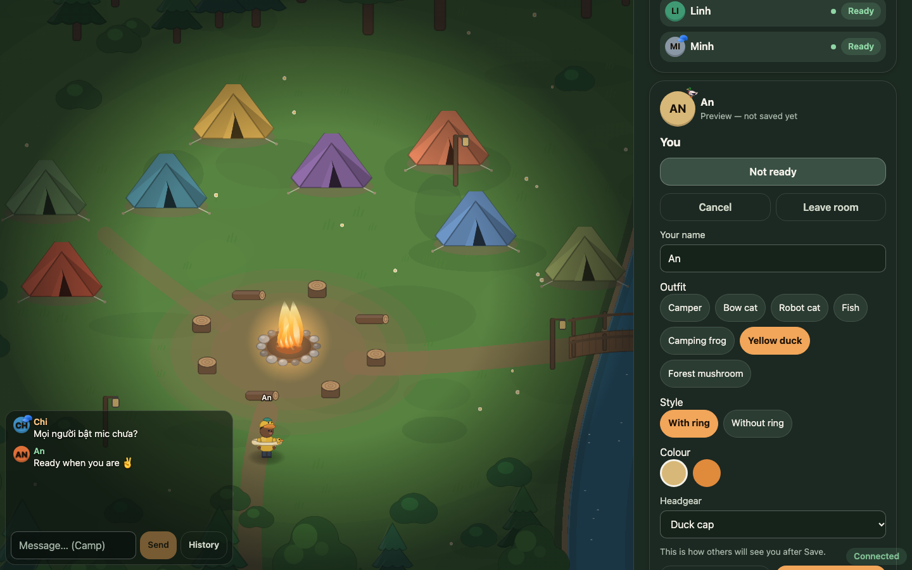
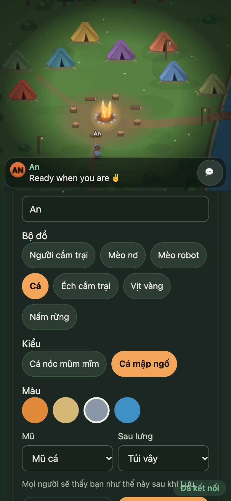
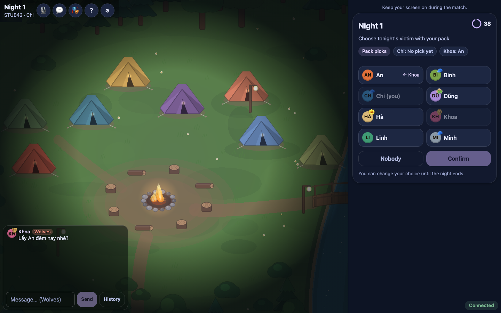

#  Moonveil

**Werewolf by the campfire.** Moonveil is a social deduction game played in the browser. Each player uses their own phone or laptop, and you talk to each other inside the game. Matches take 7 to 15 players. There's nothing to install and no account to create: you pick a name and a look, then join.

### ▶ [Play now at www.moonveil.id.vn](https://www.moonveil.id.vn/)

<p>
  
  
</p>
<p>
  
</p>

## What's in the game

- **Six roles:** Wolf, Villager, Seer, Guard, Witch and Hunter. The deck adjusts to the number of players, and the host can change the counts in the lobby. The village wins when no Wolves are left; the Wolves win once they are at least as many as everyone else alive.
- **Automatic or moderated.**
  - In an *automatic* room, the app runs night and day on timers.
  - In a *moderated* room, the person who creates the room doesn't play. They narrate and set the pace from a console that shows every night choice, and they can enter a hand count for the final vote or end the match.
- **In-game voice.** Everyone talks around the camp by day, and the Wolves get a private channel at night. You join voice with one tap, can mute at any time, or play by text. For a group sitting in one room there's a *Together in one room* mode: voice stays off and the Wolves text each other at night.
- **Ghosts.** Eliminated players become ghosts. They drift freely around the camp, hear the public discussion and talk with other ghosts. The living can't see or hear them, and ghosts never hear the Wolves. Every role is revealed when the match ends.
- **Reconnect.** If your phone locks or the network drops, reopen the game in the same browser and you're back in your seat with the same role and what you knew. Choices you already made still count. If every player is offline, the timers pause. Rooms also survive a server restart.
- **Chat that's always on screen.** It shows the channel you can use right now (Camp, Wolves or Ghosts), and the full history is one tap away.
- **Costumes.** There are seven outfits: Camper, Bow cat, Robot cat, Fish, Camping frog, Yellow duck and Forest mushroom. You can change the style, colour, headgear and accessories. What you look like never hints at your role.
- **Phone and laptop.** It works on phones in portrait and landscape, and on laptops. You move with the keyboard on a laptop, and with a virtual joystick or by tapping on a phone. The game is in English and Vietnamese: it follows your browser's language, and you can switch it in Settings.

## How to play

1. **Open [www.moonveil.id.vn](https://www.moonveil.id.vn/).** Enter your name and choose a look.
2. **Start a room.**
   - Choose where you're playing: *Online, voices in the game* or *Together in one room*.
   - Then choose *Create & play* (automatic) or *Create & moderate* (you run the match and don't play).
3. **Invite the others.** Share the invite link or the room code from the lobby; the host's screen also shows a QR code. A friend who opens the link only needs a name and a look.
4. **In the lobby,** walk around the camp, check your microphone, join voice and press *Ready*. The host starts the match once 7–15 players are ready.
5. **Play.**
   - Your role card is for your eyes only.
   - At night, roles with a power choose in secret.
   - By day the village talks, votes for someone to put on trial, hears their defence, and then votes Yes or No.
   - Tap **?** in the game for the rules. The short version is in [docs/rules/QUICK_REFERENCE.md](docs/rules/QUICK_REFERENCE.md).
6. **Keep your screen on** during a match. If you drop out, reopen the same link in the same browser to rejoin.

## Run it locally

**You need** Node.js 24.12 or newer (see `engines` in `package.json`) and the npm that ships with it. Run every command from the repository root.

```sh
git clone https://github.com/clongnguyen6/moonveil.git
cd moonveil
node scripts/env.mjs npm ci   # install the workspace dependencies
npm run dev                   # game server on :4100, Vite on :4101; open http://127.0.0.1:4101
```

`scripts/env.mjs` keeps npm's cache, temp files and Playwright browsers inside the repo in `.cache/`, which git ignores. The root npm scripts already go through it.

To run a production build that the game server serves itself:

```sh
npm run build                 # builds apps/web into apps/web/dist
npm start                     # http://127.0.0.1:4100
```

`HOST=0.0.0.0 npm start` makes the game reachable from phones on your network. Browsers only allow the microphone on HTTPS (or `localhost`), though, so voice won't work for phones over plain HTTP. See [docs/voice/SECURE_CONTEXT.md](docs/voice/SECURE_CONTEXT.md) and [docs/architecture/0002-lan-https-options.md](docs/architecture/0002-lan-https-options.md).

### Configuration

There's no `.env` file. The server reads plain environment variables, and with none set it runs locally with text chat and no voice. Each variable is documented at the top of [`apps/server/src/main.ts`](apps/server/src/main.ts).

| Variable | Purpose |
|---|---|
| `PORT`, `HOST` | Where the server listens (default `127.0.0.1:4100`) |
| `STATIC_DIR` | Web build to serve (default `apps/web/dist`) |
| `MOONVEIL_PUBLIC_ORIGIN` | The public URL of a hosted deploy |
| `MOONVEIL_ALLOWED_ORIGINS` | Extra origins allowed to connect, comma-separated |
| `MOONVEIL_LAN` | `0` hides this machine's network addresses from invite links |
| `MOONVEIL_DATA_DIR`, `MOONVEIL_PERSIST` | Where rooms are saved so they survive a restart (`MOONVEIL_PERSIST=0` turns saving off) |
| `MOONVEIL_ROOM_IDLE_MS` | How long a room with nobody connected stays open (default 30 minutes) |
| `MOONVEIL_REVISION` | Revision reported by `GET /api/status` |
| `LIVEKIT_URL`, `LIVEKIT_PUBLIC_WS`, `LIVEKIT_API_KEY`, `LIVEKIT_API_SECRET` | Voice through a [LiveKit](https://livekit.com/) server. Set all four or none. The key and secret are secrets: keep them in your host's secret settings, never in the repo |

Variables whose names contain `TEST` or `FIXTURE`, plus `MOONVEIL_ENGINE`, are for automated tests only. For hosting on Railway with LiveKit Cloud, including which variables to set, see [docs/architecture/0010-railway-livekit-cloud.md](docs/architecture/0010-railway-livekit-cloud.md).

### Tests

```sh
npm run typecheck       # TypeScript, every workspace
npm test                # unit and integration tests, every workspace
npm run e2e:install     # one-time: Playwright Chromium headless shell + WebKit into .cache/
npm run e2e             # multi-browser tests: desktop Chromium, mobile Chromium, mobile WebKit
npm run check           # all three of the above
```

Longer suites you have to run on purpose:

- `npm run e2e:matches`: full matches on the real rules engine, 7–10 browsers, both modes.
- `npm run e2e:matches:voice`: the same, with a local LiveKit server.
- `npm run e2e:ui`: UI flows at laptop and phone sizes.
- `npm run e2e:scale` and `npm run bench`: load runs.

The harness is described in [docs/architecture/0006-acceptance-harness.md](docs/architecture/0006-acceptance-harness.md).

On macOS, Playwright's WebKit also writes a few files outside the repo, under `~/Library/Preferences`, `~/Library/WebKit` and `~/Library/Caches` (`org.webkit.Playwright`). This can't be redirected.

## Project layout

| Path | What it is |
|---|---|
| `apps/server` | Node game server: rooms, HTTP + WebSocket on one port, saving rooms, voice access |
| `apps/web` | Browser client (React + Vite): screens, chat, settings |
| `packages/rules` | Rules engine: roles, night and day, votes, victory |
| `packages/protocol` | Messages shared by client and server, with validation |
| `packages/scene` | The camp scene (PixiJS): map, avatars, costumes, ghosts |
| `packages/voice` | LiveKit adapter: server side (who may hear and speak) and browser client |
| `e2e` | Playwright harness that drives many browser players at once |
| `deploy`, `scripts` | Hosting config, dev runner, test runner, post-deploy check |
| `docs` | Rules, architecture decisions, UI, visual and voice notes |

## Documentation and contributing

There's no contribution guide yet. These docs explain how the parts fit together, and `npm run check` should pass before any change.

- **Rules:**
  - [quick reference](docs/rules/QUICK_REFERENCE.md);
  - [full proposal](docs/rules/PROPOSAL.md), which separates approved and provisional rules;
  - [narration](docs/rules/NARRATION.md);
  - [engine API](packages/rules/API.md).
- **Architecture:**
  - [stack and information isolation](docs/architecture/0001-stack-and-authority.md);
  - [voice seam](docs/architecture/0004-voice-seam.md);
  - [costume contract](docs/architecture/0011-appearance-contract.md);
  - everything else in [docs/architecture](docs/architecture).
- **Client and scene:**
  - [screen map and flow](docs/ui/FLOW.md);
  - [scene package](packages/scene/README.md);
  - [voice package](packages/voice/README.md);
  - [voice decision](docs/voice/RECOMMENDATION.md).

## Limitations

- **Players:** 7–15 per match. There are no spectators, and you can't join a room that's full or already playing.
- **Voice requirements:**
  - **What it needs:** HTTPS (or `localhost`), microphone permission and a LiveKit server. The public site uses LiveKit Cloud. If you host it yourself you need your own LiveKit server, or you play without voice.
  - **Rooms without voice:** *Together in one room* rooms have no voice by design.
  - **Moderators:** they can listen but not speak, so a remote moderator can't be heard in the game.
- **Testing:** the automated tests run in desktop and mobile *browser emulation* (Playwright Chromium and WebKit) with simulated players. They aren't tests on real devices. Real phones may behave differently, for example in how iOS asks for microphone permission.
- **Rules:** some details are still provisional (marked 🟡 in the [quick reference](docs/rules/QUICK_REFERENCE.md)).
- **Hosting:** each room lives in one server process. Rooms are saved to disk and survive a restart. A room closes after 30 minutes with nobody connected (by default).
- **Missed turns:** a phone that sleeps disconnects. Rejoining restores your seat, but a timed choice you missed counts as "do nothing".

## License

No license file yet.
